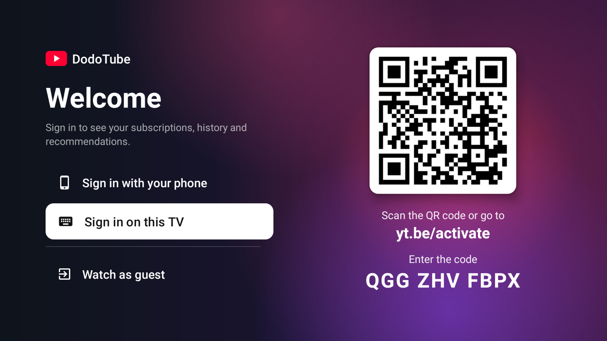
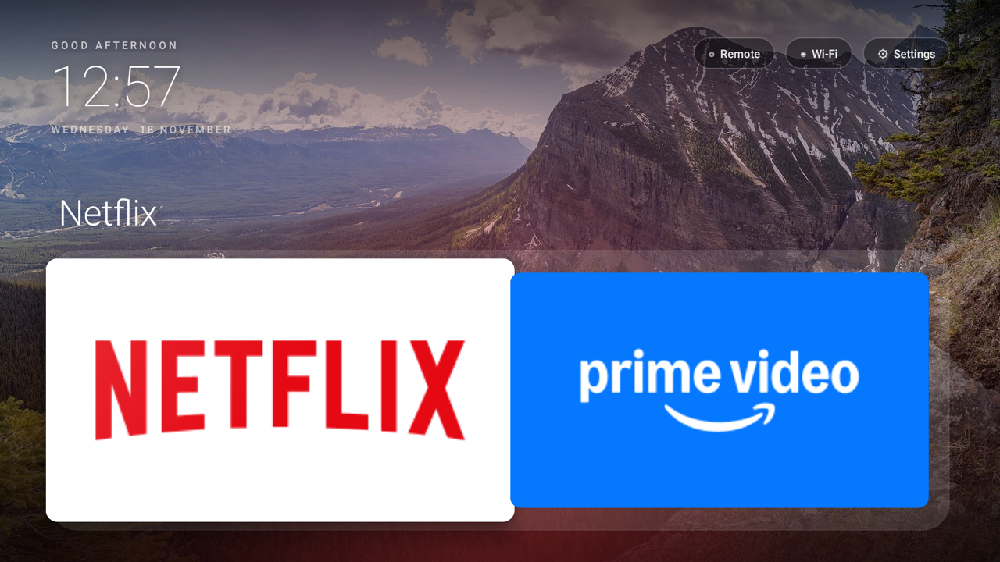

<div align="center">

# 📺 TV Box

**Turn a cheap Android TV box into a calm, ad-free, Apple TV-style living-room device,
simple enough for anyone in the family.**


[**Download the APKs**](../../releases/latest) · [Build from source](docs/BUILDING.md) · [What's inside](#-whats-inside)



</div>

---

## ✨ Why

Stock TV boxes ship with promo rows, telemetry, ad-supported channels and a launcher that changes every
update. This project strips that away and replaces it with **four small, focused apps** and a
**reversible debloat**, all installed over Wi-Fi ADB from a Mac or Windows PC, **no root**.

Design rules for every screen: dark glass, rounded corners, a white focus that's easy to follow from the
sofa, smooth motion on every focus change, big type, and nothing that can be pressed by accident.

## 📦 What's inside

| | App | Package | Based on |
|---|---|---|---|
| 🏠 | **TV Home**: the home screen | `com.mihir.tvhome` | [tv-home](https://github.com/mihirgupta0900/tv-home) |
| ▶️ | **DodoTube**: ad-free YouTube, redesigned | `org.smarttube.stable.tvhome` | [SmartTube](https://github.com/yuliskov/SmartTube) |
| 🎵 | **DodoMusic**: ad-free YouTube Music, redesigned | `com.auramusic.app.tvhome` | [AuraMusic](https://github.com/teamauramusic/auramusic) |
| 🎛️ | **Remote Remap**: choose what each remote button opens | `com.mihir.remap` | tv-home |

DodoTube and DodoMusic use a `.tvhome` package suffix, so they install **next to** the official
SmartTube / AuraMusic instead of replacing them.

### 🏠 TV Home


- Wallpaper, big clock, a dock of large app tiles, an app grid below
- **Edit the dock on the TV**: hold OK → move, add/remove, rename, app info, uninstall
- The remote's **All Apps** button jumps to the grid; a **Remote** pill opens Remote Remap
- DodoTube / DodoMusic show the familiar YouTube / YouTube Music artwork
- Built with bare SDK tools: no Gradle, builds in seconds

<br clear="right">

### ▶️ DodoTube
- **Prime Video-style home**: big hero with title and details over the video's artwork, picture-only cards
- **The focused video plays silently in the hero** after a short pause, blending into the background
- **Icon tabs** at the top (Home, Kids, LIVE, Gaming, Music, History) instead of a big side menu;
  more sections can be switched on in Settings
- **Slim side rail** (Profile, Search, Settings) on a dark strip that cards slide under
- **YouTube-style welcome page**: when nobody is signed in it opens by itself with a QR code and an
  activation code (*Sign in with your phone*, *Sign in on this TV*, *Watch as guest*). Codes renew
  themselves and errors never reach the screen
- Redesigned player, channel pages, settings grid, search and side panels
- Sign-in survives every update (updates are always in place)

### 🎵 DodoMusic
- Full TV redesign of AuraMusic in Jetpack Compose for TV: frosted glass, big artwork, smooth focus
- Ad-free YouTube Music with lyrics, built for the remote

### 🎛️ Remote Remap
- An accessibility service that remaps remote buttons (e.g. the Mi TV+ or microphone key) to any app
- Pick mappings **on the TV**: button → app list
- Power, Back, Home, the D-pad and OK can **never** be remapped, so the TV can't be locked out

### 🧹 Debloat
- Curated lists per device in [`tv-home/examples/`](tv-home/examples): manufacturer analytics, promo
  channels, ad services, Play Games, TalkBack, assistant UI…
- Packages are **disabled, never uninstalled**: one command restores everything

## 🚀 Quick start (APKs)

1. On the TV: **Settings → About → Build** ×7 → **Developer options → USB debugging**.
2. Grab the APKs from the [latest release](../../releases/latest).
3. Install over Wi-Fi:

```bash
adb connect <tv-ip>:5555            # accept "Allow USB debugging?" on the TV
adb install -r DodoTube-*.apk
adb install -r DodoMusic-*.apk
adb install -r TV-Home-*.apk
adb install -r Remote-Remap-*.apk
```

4. Make TV Home the default home screen:

```bash
adb shell cmd package set-home-activity --user 0 com.mihir.tvhome/.MainActivity
```

5. Turn on Remote Remap: **Settings → Accessibility → Remote Remap**.

> **Note:** release APKs are signed with the maintainer's key. Builds from your own key can't update
> them in place: uninstall first, or build everything yourself.

## 🛠️ Build from source

```bash
bash tools/setup-new-mac.sh                       # JDK 17 + 21, Android SDK, NDK (no Homebrew, no sudo)
DEVICE=192.168.1.42:5555 bash smarttube/build-and-install-tv.sh
```

Full guide (Windows too, signing keys, debloat): **[docs/BUILDING.md](docs/BUILDING.md)**.

## 🗂️ Project layout

```text
tv-box/
├── tv-home/
│   ├── launcher/        TV Home (home screen)
│   ├── remap/           Remote Remap (accessibility service)
│   ├── tools/           debloat, find-tv and adb helper scripts
│   └── examples/        per-device debloat lists
├── smarttube/           DodoTube (SmartTube + TV Box redesign, incl. MediaServiceCore)
├── auramusic/           DodoMusic (AuraMusic + TV redesign)
├── tools/               toolchain set-up for macOS and Windows
└── docs/                building guide and screenshots
```

## ✅ Tested on

| Device | OS |
|---|---|
| Xiaomi Mi Box S (1st gen, MIBOX4) | Android TV 9 |
| Xiaomi TV Box S (3rd gen) | Google TV / Android 14 |

## 🙏 Credits

Standing on the shoulders of great open-source work:

- **[SmartTube](https://github.com/yuliskov/SmartTube)** by yuliskov (MIT)
- **[AuraMusic](https://github.com/teamauramusic/auramusic)** by Team AuraMusic (GPL-3.0)
- **[tv-home](https://github.com/mihirgupta0900/tv-home)** by Mihir Gupta (MIT)

## ⚖️ License & disclaimer

Each component keeps its upstream license: `smarttube/` and `tv-home/` are **MIT**, `auramusic/` is
**GPL-3.0** (see the `LICENSE` file in each folder).

This project is not affiliated with, endorsed by or connected to Google, YouTube, Xiaomi or any app
mentioned. All trademarks belong to their owners. Use it on devices you own.
